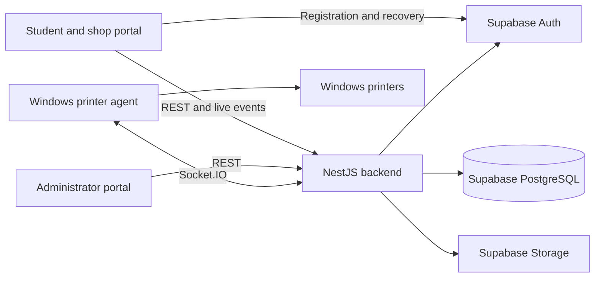

<div align="center">

# PrintFlow

<a href="https://readme-typing-svg.herokuapp.com">
  
</a>

<p align="center">
  <a href="https://github.com/JudeeeeeV/printflow-frontend"></a>
  <a href="https://github.com/JudeeeeeV/printflow-backend"></a>
  <a href="https://github.com/JudeeeeeV/printflow-admin"></a>
</p>

<p align="center">
  
  
</p>

</div>

**Campus document printing, from submission to collection.**

PrintFlow brings students, print-shop operators, and platform administrators into one coordinated printing workflow. It connects online order preparation and payment review with shop queues, registered Windows printing computers, and confirmed collection.

This is the **head repository and documentation hub** for the project. Application source code is maintained in three separate repositories, each with its own dependencies, configuration, and deployment.

[Open the student and shop portal](https://printflow-frontend-aje0.onrender.com/index.html) | [Frontend source](https://github.com/JudeeeeeV/printflow-frontend) | [Backend source](https://github.com/JudeeeeeV/printflow-backend) | [Admin source](https://github.com/JudeeeeeV/printflow-admin)

## Contents

- [Project description](#1-project-description)
- [Features and responsibilities](#2-features-and-responsibilities)
- [Technology stack](#3-technology-stack)
- [Prerequisites](#4-prerequisites)
- [Installation and local setup](#5-installation-and-local-setup)
- [Environment variables](#6-environment-variables)
- [Running and building](#7-running-and-building-the-application)
- [Deployment](#8-deployment)
- [Related repositories](#9-related-repositories)
- [Contributors](#contributors)

## 1. Project Description

PrintFlow supports the operational steps of campus printing: selecting a shop, preparing a document, reviewing payment, producing the output, and recording collection. The system keeps payment status separate from production progress so that each decision has a clear meaning and history.

| User                 | Main responsibilities                                                                                                                     |
| -------------------- | ----------------------------------------------------------------------------------------------------------------------------------------- |
| Students             | Choose a print shop, upload documents, configure printing, save drafts, submit orders, provide payment evidence, and track progress.      |
| Print-shop operators | Manage shop details and availability, review payments and orders, dispatch reviewed print batches, confirm output, and record collection. |
| Administrators       | Review shop verification, resolve payment disputes, manage administrator access, and oversee registered printer agents.                   |

This repository explains how those applications fit together and where to start. Detailed API behavior, database changes, and agent-release procedures belong in the backend documentation; application-specific setup belongs in each application's README.

## 2. Features and Responsibilities

### Repository directory

| Repository                                                            | Purpose                                                                                                  | Setup guide                                                                             |
| --------------------------------------------------------------------- | -------------------------------------------------------------------------------------------------------- | --------------------------------------------------------------------------------------- |
| [printflow](https://github.com/JudeeeeeV/printflow)                   | Project overview, architecture, and cross-repository setup.                                              | This README.                                                                            |
| [printflow-frontend](https://github.com/JudeeeeeV/printflow-frontend) | Student ordering and the shop's Live Queue, Analytics, Printer Agent, and Settings workspaces.           | [Frontend README](https://github.com/JudeeeeeV/printflow-frontend/blob/main/README.md). |
| [printflow-backend](https://github.com/JudeeeeeV/printflow-backend)   | Shared API, authentication, authorization, document processing, payments, migrations, and Windows agent. | [Backend README](https://github.com/JudeeeeeV/printflow-backend/blob/main/README.md).   |
| [printflow-admin](https://github.com/JudeeeeeV/printflow-admin)       | Administrator authentication, shop verification, disputes, account management, and agent oversight.      | [Admin README](https://github.com/JudeeeeeV/printflow-admin/blob/main/README.md).       |

### Core workflow

1. **Prepare an order.** A student chooses an available shop, selects a document, and configures paper size, orientation, copies, and color mode. Drafts preserve work for later.
2. **Submit and validate.** Browser checks provide early feedback; the backend performs definitive validation and normalizes PDF, DOCX, PNG, JPG/JPEG, and WEBP files into printable PDFs.
3. **Authorize production.** GCash verification authorizes printing without separate shop acceptance. Cash-on-pickup orders retain an explicit accept/reject decision, with payment due at collection.
4. **Produce and confirm.** Operators review print batches and dispatch them through a registered Windows agent or use the supported manual workflow. Agent submission is recorded separately from confirmation of physical output.
5. **Record collection.** GCash orders retain confirmed handover. Recording eligible cash collection settles payment and completes the cash order without a separate cash handover action.

Live updates, analytics, receipt history, disputes, and audit records support the workflow. AI-assisted shop-permit review is optional and subject to administrator review; ordinary file checks do not certify AI print quality or minimum DPI.

### Architecture



The backend enforces business rules, roles, and ownership. It accesses PostgreSQL through Supabase JS/PostgREST and restricted database functions. Private file access and device authentication are managed by the backend. Production browser/API connections use HTTPS, and agent connections use secure WebSockets.

## 3. Technology Stack

<div align="center">
  
</div>

| Layer                             | Main technologies                                                                                           |
| --------------------------------- | ----------------------------------------------------------------------------------------------------------- |
| Student and shop application      | React 19, TypeScript, Vite 8, Tailwind CSS 4, Carbon icons, Framer Motion, Recharts, MapLibre, Supabase JS. |
| Administrator application         | React 19, TypeScript, Vite 8, Tailwind CSS 4, Axios, Recharts, and TOTP-backed authentication.              |
| API and live services             | Node.js 24, NestJS 11, TypeScript, Socket.IO, server-sent events, and scheduled tasks.                      |
| Data, authentication, and storage | Supabase PostgreSQL, Auth, Storage, row-level security, and restricted database functions.                  |
| Document preparation and printing | `pdf-lib`, Sharp, JSZip, LibreOffice Writer, and the packaged Windows printer agent.                        |
| Validation and deployment         | ESLint, Node regression tests, Jest, Supertest, PGlite, Docker, and Render blueprints.                      |

## 4. Prerequisites

- **Node.js `>=24.14.1 <25`**, npm, and Git. All three application manifests use this Node.js range; the deployment configuration targets 24.14.1.
- Access to the team's **existing, initialized development Supabase project**, approved configuration, and migration history. The tracked SQL files are incremental migrations, not a complete initial schema for an empty database.
- LibreOffice on the API host for DOCX conversion, or Docker using the backend's included Dockerfile.
- A maintainer-provisioned administrator account and TOTP authenticator when using the admin portal.
- A Windows computer and working printer when exercising agent-based printing. Shop staff use the packaged installer; developer tools are not required on their computer.

## 5. Installation and Local Setup

### Clone the repositories

Use sibling directories so that each repository remains an independent Git working tree:

```bash
mkdir printflow-workspace
cd printflow-workspace
git clone https://github.com/JudeeeeeV/printflow.git
git clone https://github.com/JudeeeeeV/printflow-backend.git
git clone https://github.com/JudeeeeeV/printflow-frontend.git
git clone https://github.com/JudeeeeeV/printflow-admin.git
```

```text
printflow-workspace/
  printflow/             Project documentation
  printflow-backend/     API, migrations, and Windows agent
  printflow-frontend/    Student and shop web application
  printflow-admin/       Administrator web application
```

If these repositories are already cloned, use the existing working directories. The head repository has no application install or development-server command.

### Install application dependencies

From `printflow-workspace`, install each application separately:

```bash
cd printflow-backend
npm install
cd ../printflow-frontend
npm install
cd ../printflow-admin
npm install
cd ..
```

### Configure the development environment

1. Follow each application's README to create or update its local `.env`. The backend has a tracked `.env.example`; the frontend and admin READMEs provide inline examples. Preserve existing local settings.
2. Use the same approved development Supabase project throughout. Have its maintainer review outstanding migrations before starting the backend.
3. Set both web applications' `VITE_API_URL` explicitly to the local API, and align the backend's allowed origins with the local ports below.
4. Configure email verification/recovery in Supabase Auth. Microsoft sign-in, CAPTCHA, administrator enrollment, and installer publishing have additional conditional setup in the component guides.

The head repository does not provide a shared `.env`, package installation, or database bootstrap. Database reset, cleanup, seeding, and installer publication are separate maintenance operations.

## 6. Environment Variables

| Component | Main settings                                                                                                                                                                                        | Authoritative reference                                                                        |
| --------- | ---------------------------------------------------------------------------------------------------------------------------------------------------------------------------------------------------- | ---------------------------------------------------------------------------------------------- |
| Backend   | `SUPABASE_URL`, server-only `SUPABASE_SERVICE_ROLE_KEY`, `JWT_SECRET`, `TOTP_ENCRYPTION_KEY`, `AGENT_JWT_SECRET`, `FRONTEND_URL`, and `ADMIN_URL`; optional integration and document-limit settings. | [Backend configuration](https://github.com/JudeeeeeV/printflow-backend/blob/main/README.md).   |
| Frontend  | `VITE_API_URL`, `VITE_SUPABASE_URL`, `VITE_SUPABASE_ANON_KEY`, conditional `VITE_TURNSTILE_SITE_KEY`, and optional map/routing overrides.                                                            | [Frontend configuration](https://github.com/JudeeeeeV/printflow-frontend/blob/main/README.md). |
| Admin     | `VITE_API_URL`; the application appends the `/admin` API prefix.                                                                                                                                     | [Admin configuration](https://github.com/JudeeeeeV/printflow-admin/blob/main/README.md).       |

### Local origins

| Setting                 | Local value             |
| ----------------------- | ----------------------- |
| Frontend `VITE_API_URL` | `http://localhost:3000` |
| Admin `VITE_API_URL`    | `http://localhost:3000` |
| Backend `FRONTEND_URL`  | `http://localhost:5173` |
| Backend `ADMIN_URL`     | `http://localhost:3001` |

`VITE_` values are included in browser JavaScript. Only browser-safe public Supabase configuration belongs there; privileged keys, signing secrets, TOTP keys, and account credentials stay out of web bundles and source control. Configure the backend's TOTP encryption key even for local development.

Origins identify a scheme, hostname, and port. Do not include `/index.html` or another path in `FRONTEND_URL` or `ADMIN_URL`. Restart Vite after local environment changes and rebuild static sites when changing deployment configuration. Set local API targets explicitly because the browser applications have a deployed-API fallback.

## 7. Running and Building the Application

### Start the applications

Open three terminals, each starting from `printflow-workspace`:

| Terminal            | Directory            | Command             | Local address                                   |
| ------------------- | -------------------- | ------------------- | ----------------------------------------------- |
| Backend             | `printflow-backend`  | `npm run start:dev` | [API health](http://localhost:3000/health).     |
| Student/shop portal | `printflow-frontend` | `npm run dev`       | [http://localhost:5173](http://localhost:5173). |
| Admin portal        | `printflow-admin`    | `npm run dev`       | [Admin login](http://localhost:3001/login).     |

For example, the backend terminal runs:

```bash
cd printflow-backend
npm run start:dev
```

The main frontend normally uses port 5173. The admin configuration reserves port 3001 with strict port selection. If the frontend uses another port, update the backend's allowed origin to match.

### Build and validate

Run `npm run build` inside each application repository. Web builds are written to `dist/`; after its build, the API runs with `npm run start:prod`. The backend Dockerfile provides the production LibreOffice runtime.

Each application defines its own tests and lint commands. Follow its README for validation, database regression tests, and any commands that modify files. A successful build or process-health response does not verify authentication, email delivery, deployed migrations, payment operations, or physical printing.

## 8. Deployment

| Service                 | Address                                                                                                                                 | Deployment information                                                                |
| ----------------------- | --------------------------------------------------------------------------------------------------------------------------------------- | ------------------------------------------------------------------------------------- |
| Student and shop portal | [Open PrintFlow](https://printflow-frontend-aje0.onrender.com/index.html)                                                               | Team-supplied public application address.                                             |
| Backend API             | [Configured API](https://printflow-backend-wen3.onrender.com) and [health endpoint](https://printflow-backend-wen3.onrender.com/health) | Referenced by both clients; official production designation awaits team confirmation. |
| Administrator portal    | URL awaiting team confirmation.                                                                                                         | Deployment details remain in the admin repository.                                    |

Frontend and API-health reachability were checked on November 10, 2026. These checks establish HTTP availability, not full workflow readiness.

The frontend and admin repositories contain Render **Static Site** blueprints using `npm ci && npm run build`, `dist` publishing, and client-side route rewrites. The backend blueprint deploys a **Docker web service** with LibreOffice and `/health` monitoring.

Configure build/runtime values privately in the relevant hosting service. Apply approved database migrations separately; application deployment does not run SQL migrations automatically. Coordinate compatible API and browser revisions, HTTPS origins, Supabase Auth settings, CAPTCHA, and agent-release metadata.

The API server and the shop's Windows computer are separate installations. Use the backend's [Windows agent instructions](https://github.com/JudeeeeeV/printflow-backend/blob/main/README.md) for shop setup and developer release procedures.

## 9. Related Repositories

- [PrintFlow project hub](https://github.com/JudeeeeeV/printflow)
- [Student and shop frontend](https://github.com/JudeeeeeV/printflow-frontend)
- [Backend API and Windows printer agent](https://github.com/JudeeeeeV/printflow-backend)
- [Administrator portal](https://github.com/JudeeeeeV/printflow-admin)

## Contributors

- Jude Mikael Valencia
- Karol Vincent Bebedor
- Noeh Arbee Boiser
- Aldrin Suse
