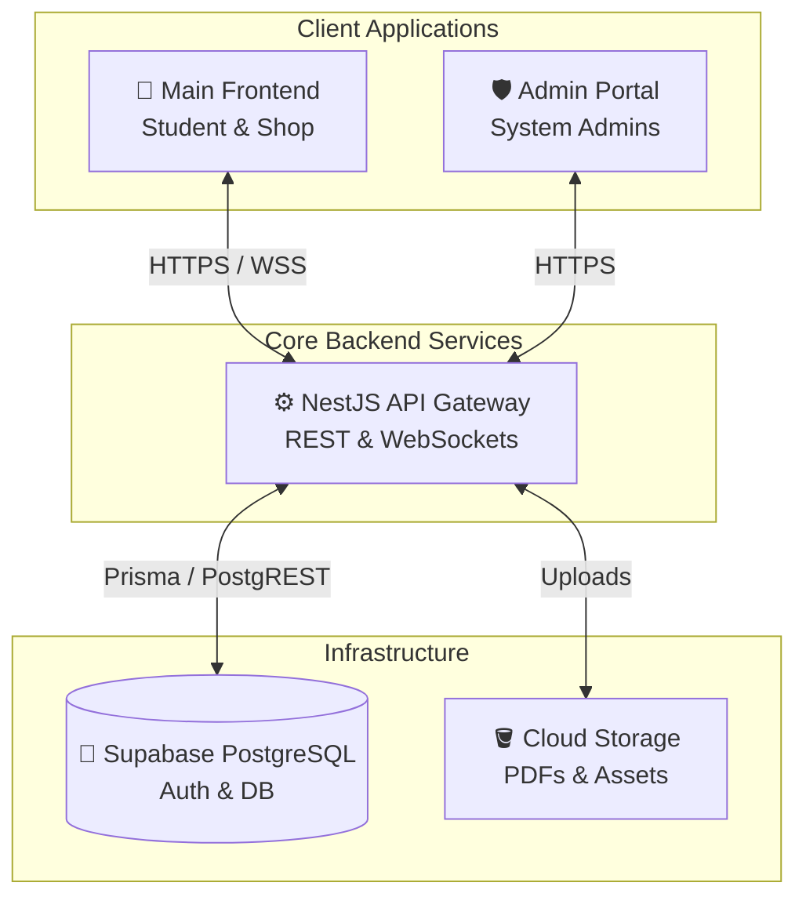

<div align="center">

# 🖨️ PrintFlow

<a href="https://readme-typing-svg.herokuapp.com">
  
</a>

<p align="center">
  <a href="https://github.com/JudeeeeeV/printflow-frontend"></a>
  <a href="https://github.com/JudeeeeeV/printflow-backend"></a>
  <a href="https://github.com/JudeeeeeV/printflow-admin"></a>
</p>

<p align="center">
  
  
  
</p>

---

<!-- PRODUCT DEMO PLACEHOLDER -->


</div>

<br />

<details>
<summary><b>📖 Table of Contents</b></summary>

- [About The Project](#-about-the-project)
- [Repository Directory](#-repository-directory)
- [Architecture](#-architecture)
- [Tech Stack](#-tech-stack)
- [Quick Start & Setup](#-quick-start--setup)
- [License](#-license)

</details>

## 🚀 About The Project

PrintFlow is a comprehensive, multi-platform ecosystem designed to modernize and automate printing operations for university campuses and local print shops. It bridges the gap between **Students** submitting documents, **Shops** managing printing queues, and **Administrators** overseeing the platform and resolving disputes.

The project is modularized into three distinct environments to ensure high scalability, security, and strict separation of concerns.

---

## 📂 Repository Directory

PrintFlow operates as a monorepo-style ecosystem across three dedicated repositories. Click the badges below to navigate to each specific codebase:

| Module | Description | Repository Link |
| :--- | :--- | :--- |
| **🎨 Main Frontend** | The unified portal for Students (to upload files & checkout) and Print Shops (to manage queues & analytics). | [](https://github.com/JudeeeeeV/printflow-frontend) |
| **⚙️ Backend API** | The central NestJS server handling business logic, Supabase integration, real-time sockets, and payments. | [](https://github.com/JudeeeeeV/printflow-backend) |
| **🛡️ Admin Portal** | The secure dashboard for platform administrators to manage shop onboarding, revenue, and user disputes. | [](https://github.com/JudeeeeeV/printflow-admin) |

---

## 🏗 Architecture

The system utilizes a modern decoupled architecture. The Backend acts as the single source of truth, communicating securely with Supabase for data persistence and authentication, while serving both the Main Frontend and the Admin Portal.



---

## 💻 Tech Stack

We leverage industry-leading technologies to deliver a blazing fast and reliable experience.

<div align="center">
  
</div>

---

## 🏎 Quick Start & Setup

Want to spin up the entire PrintFlow ecosystem locally? Follow these steps to run all three environments concurrently.

### 1. Prerequisites
Ensure you have the following installed:
- [Node.js](https://nodejs.org/) (v18+)
- [npm](https://npmjs.com/) or [yarn](https://yarnpkg.com/)
- A [Supabase](https://supabase.com/) account for the database

### 2. Clone the Repositories
Since the project is split into three repos, clone them into a central `printflow` directory:

```bash
mkdir printflow && cd printflow

git clone https://github.com/JudeeeeeV/printflow-frontend.git
git clone https://github.com/JudeeeeeV/printflow-backend.git
git clone https://github.com/JudeeeeeV/printflow-admin.git
```

### 3. Install Dependencies
Install dependencies for all three projects. You can do this quickly by opening three terminal tabs or running:

```bash
# Frontend
cd printflow-frontend && npm install

# Backend
cd ../printflow-backend && npm install

# Admin
cd ../printflow-admin && npm install
```

### 4. Environment Variables
You will need to configure `.env` files for each repository. Create a `.env` in the root of each project using their respective `.env.example` templates. 

*(Make sure to add your Supabase URL, Anon Key, and Service Role keys where appropriate!)*

### 5. Spin Up the Environments
Open three separate terminal windows and start the development servers:

**Terminal 1 (Backend):**
```bash
cd printflow-backend
npm run start:dev
# API will run on http://localhost:3000
```

**Terminal 2 (Frontend):**
```bash
cd printflow-frontend
npm run dev
# Frontend will run on http://localhost:5173
```

**Terminal 3 (Admin):**
```bash
cd printflow-admin
npm run dev
# Admin will run on http://localhost:3001
```

> [!TIP]
> **Pro-Tip:** If you prefer running them all in one terminal window, consider using a package like `concurrently` from a root `package.json`.

---

## 📜 License

Distributed under the MIT License. See `LICENSE` for more information.

<div align="center">
  <sub>Built with ❤️ for better campus printing.</sub>
</div>
